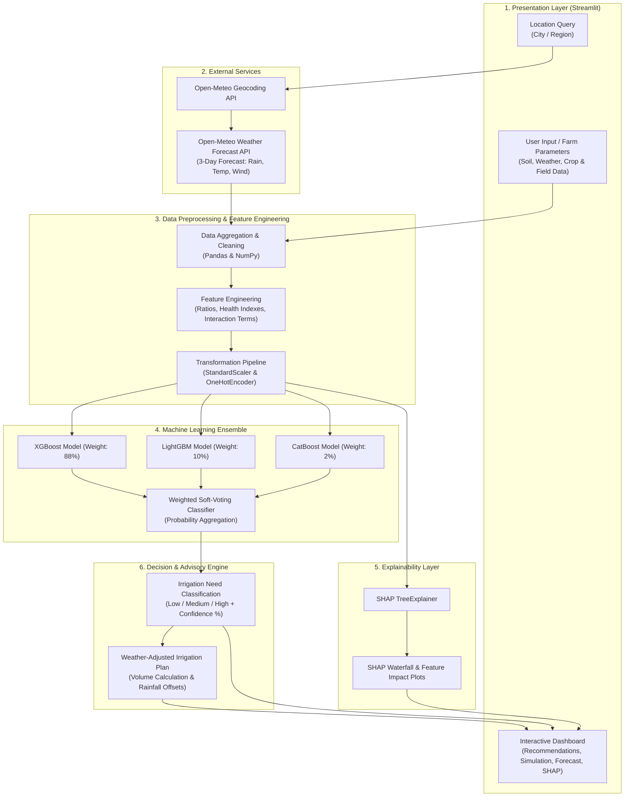

# Precision Irrigation AI System 🌾

## Overview
The **Precision Irrigation AI System** is an advanced, data-driven web application designed to optimize water usage in agriculture. By leveraging state-of-the-art machine learning models and real-time weather forecasting, the system provides accurate, actionable recommendations on when and how much to irrigate crops.

### Here is the deployed streamlit app of Precision Irrigation System
https://precisionirrigationsystem-smrf36wqojgf34wlsayvy3.streamlit.app/
- It may take five minutes to wake up due to streamlit cloud free tier
## Technologies Used
- **Frontend & UI:** Streamlit
- **Machine Learning Models:** XGBoost, LightGBM, CatBoost
- **Explainable AI:** SHAP (SHapley Additive exPlanations)
- **Data Processing:** Pandas, NumPy, Scikit-Learn
- **APIs:** Open-Meteo API (for real-time weather forecasting and geocoding)
- **Model Serialization:** Joblib

## System Architecture

## What is Accomplished
- **Ensemble Prediction:** Combines the predictive power of multiple robust gradient boosting algorithms (XGBoost, LightGBM, CatBoost) to achieve an estimated 89.5% accuracy in irrigation recommendations.
- **Real-Time Forecast Integration:** Connects seamlessly with the Open-Meteo API to fetch a 3-day weather forecast based on a user-provided location. The system intelligently adjusts irrigation plans by factoring in predicted rainfall.
- **Interactive Simulation:** Allows users to adjust environmental parameters (Temperature, Humidity, Soil Moisture, Rainfall) via an intuitive slider interface to see how real-time changes impact irrigation requirements.
- **AI Explainability:** Demystifies the "black box" of machine learning by generating SHAP waterfall plots, showing precisely which environmental factors drove the model's decision.
- **Water Conservation:** Aims to reduce water waste, estimating a 34% saving in water usage compared to traditional irrigation methods.

